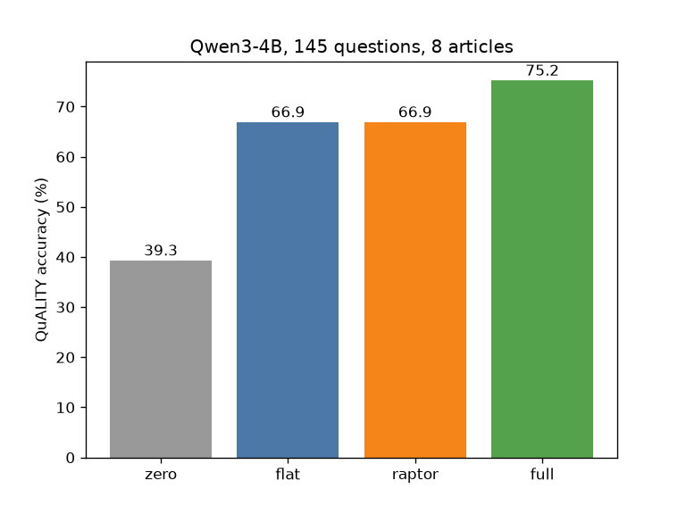

# #074 RAPTOR summaries vs flat chunks (QuALITY)

**Result:** with the same ~1,500-token context budget, RAPTOR-style collapsed-tree retrieval and flat chunk retrieval tie at **66.9%** (97/145). Zero context gets 39.3%, the full article (~5K tokens) 75.2%. Tree building cost 245 s and 82 summary calls for 8 articles, with no accuracy gain here.

| Arm | Acc | n | Mean ctx tokens |
|---|---|---|---|
| zero | 39.3% | 145 | 0 |
| flat | 66.9% | 145 | 1471 |
| raptor | 66.9% | 145 | 1475 |
| full | 75.2% | 145 | 4958 |

## Setup
- Data: `emozilla/quality` validation, 8 articles (seed 0), all 145 questions.
- Reader/summariser: Qwen/Qwen3-4B-Instruct-2507 fp16; embeddings BAAI/bge-small-en-v1.5; KMeans (~5 per cluster), 3 summary levels.
- GPU: Colab L4, ~21.6 min, ≈0.55 CU (minutes/60 x 1.54).
- Reproduce: run `scripts/raptor.py` on a GPU (`NART=8`); writes `runs.json`. Raw outputs in `results/`.
- Costs: the Claude driver's API cost is not measured; any figure would be an API-equivalent estimate only.
- Caveat: small sample (±8 pts CI), articles are short-ish (~2-5K words), 4B reader.
