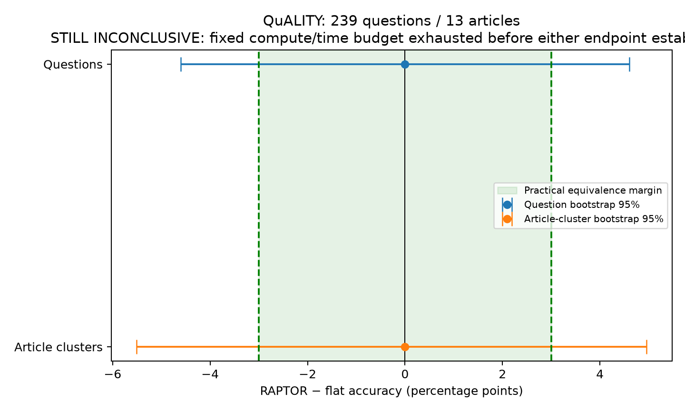

# RAPTOR versus flat retrieval: round 3

**Verdict: STILL INCONCLUSIVE — compute/time budget exhausted after infrastructure failure.** The recovered run does not settle the question. A tie is not evidence of equivalence. No new GPU allocation was made during final recovery because the existing lifecycle-window estimate already exceeded the cap.

| Measure | Result |
|---|---:|
| Saved / planned questions | 239 / 2,086 |
| Saved / planned articles | 13 / 115 |
| Flat exact MC accuracy | 159/239 = 66.53% |
| RAPTOR exact MC accuracy | 159/239 = 66.53% |
| RAPTOR minus flat | 0.00 percentage points |
| Question bootstrap 95% CI | [−4.60, +4.60] points |
| Article-cluster bootstrap 95% CI | [−5.51, +4.96] points |
| Question bootstrap 90% CI | [−3.77, +3.77] points |
| Article-cluster bootstrap 90% CI | [−4.62, +4.17] points |
| RAPTOR-only / flat-only correct | 16 / 16 |
| Exact two-sided McNemar p | 1.000 |

The advance rule required both 95% intervals above zero for superiority, both below zero for inferiority, or both 90% intervals strictly within ±3 points for equivalence. Its additional practical non-superiority endpoint required both one-sided 95% upper bounds below +3 points. None passes. Bootstrap intervals use 20,000 replicates, seed 74. Cluster resampling retains whole articles and computes the question-weighted difference. The upper endpoints of the central 90% intervals are the corresponding one-sided 95% bounds. McNemar is corroborative, not an equivalence test.

Qwen/Qwen3-8B, thinking disabled, reads both arms with constrained A/B/C/D next-token scoring. RAPTOR searches leaves plus generated summary levels; flat searches leaves only. Both use bge-small embeddings and evidence capped at 1,500 reader tokens including separators. Actual mean evidence was 1,457.4 tokens for flat and 1,472.9 for RAPTOR. Summary nodes were retrieved in 236/239 RAPTOR contexts; three context pairs were identical. There were no duplicate question keys, invalid answers or evidence-budget violations in the saved sample. The experiment tests the preserved RAPTOR-style implementation, not every possible RAPTOR configuration.

The public QuALITY validation articles were sorted by SHA256 before inference, with all questions per completed article retained. The saved prefix has 13 articles of 1,920–5,380 words (2,819–8,204 reader tokens). It is not a sample of book-length documents. Earlier rounds had 145 QuALITY questions with a smaller reader and 300 NarrativeQA questions with an F1 correctness proxy; this design changed to exact MC scoring, a stronger 8B reader, more articles and a prespecified practical equivalence endpoint. Full-split planning assumed discordance .127: at n=2,086, approximate zero-effect TOST power was 97.2%, or 86.5% with design effect 1.5. At the actual n=239, the same assumptions imply no acceptance region in the fixed-SE normal approximation, even without clustering. The planned sample-size benefit was not realized.

## Compute and provenance

NVIDIA L4, fp16. Two explicitly stopped allocations lasted 470.46 and 914.17 seconds, estimated 0.592 CU together at 1.54 CU/hour. A third allocation was created at 2026-10-15 18:48:48.882849 UTC and recorded as pruned at 2026-10-16 00:16:28.027543 UTC. Counting that window gives 21,043.77 allocated seconds overall (5.846 hours), estimated **9.002 CU**. Exact billed CU is unavailable; pruning is stale-session detection and may overstate actual remote lifetime. Accordingly the 5-CU and ~4-hour requirements cannot be certified and the window estimate violates both. No successful final explicit-stop record was recovered for allocation 3. The final recovery found no active sessions and issued `colab stop -s r3074`, which returned session not found. No other session was stopped.

The recovered controller last logged transport at 18:55:48 UTC. Locally saved article checkpoints end at article 13; unsaved remote results cannot be inferred or recovered. The README's execution refinements preserved model, prompt and statistical rules. Neither a missing final checkpoint nor failed cleanup justifies restarting the budget or claiming equivalence. Source folders were read without modification. No agents or Claude were invoked during final recovery.

Raw paired answers, logits, gold labels, evidence and levels are in `results/checkpoint/predictions.jsonl`; trees and aligned embeddings are in its `trees/` directory. Metadata, progress, sanitized lifecycle evidence, numerical statistics and integrity checks are under `results/`. Scripts implement resumable inference, download acknowledgement, analysis and auditing. The checkpoint archive is excluded as a duplicate of committed extracted files. Reproduction requires the public dataset/model downloads; follow `scripts/REPRODUCE.md` with a fresh compute budget. Final analyses were run locally with `scripts/audit.py`, `scripts/analyze.py` and `scripts/compute_audit.py`.
